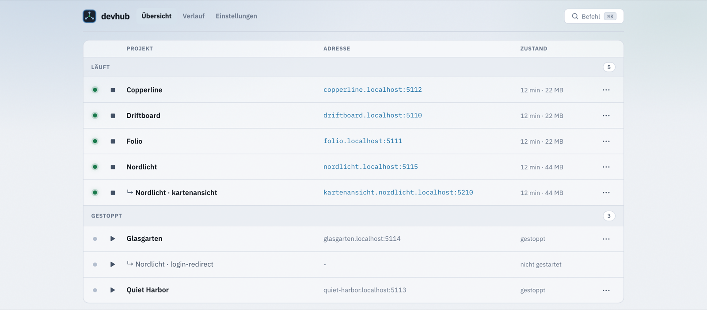
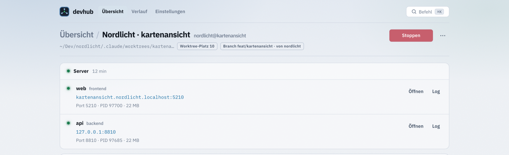

# devhub

devhub ist ein lokaler Dienst für macOS, dem alle Dev-Server deiner Projekte
gehören. Jedes Projekt bekommt einen festen Port und eine feste Adresse, etwa
`http://maptale.localhost:5123`. Gestartet und gestoppt wird nur über devhub,
egal ob du selbst tippst oder ein Coding-Agent.



## Warum

Ohne zentrale Stelle startet jeder seinen eigenen Server: du im Terminal, Cursor
in seiner Sitzung, Claude Code in einem Worktree. Vite weicht auf 5174 aus, Next
auf 3001, und irgendwann testet jemand gegen den falschen Server. Der Login fehlt,
die Daten sind andere, und alles sieht aus, als liefe es.

devhub hält pro Projekt genau eine Instanz auf genau einer Nummer. Agenten bekommen
eine Regel, die ihnen das eigene Starten verbietet, und den Befehl, den sie
stattdessen nehmen sollen. Arbeitet ein Agent in einem Git-Worktree, bekommt der
Worktree eine eigene Instanz daneben, statt dem Hauptprojekt in die Quere zu kommen.

Brauchst du nicht, wenn du an einem einzigen Projekt arbeitest und nie zwei Leute
oder Agenten gleichzeitig daran sitzen.

## Installation

Voraussetzungen: macOS, Node.js 20 oder neuer, Projekte in einem gemeinsamen
Ordner (Standard `~/Dev`). devhub hat keine npm-Abhängigkeiten.

```bash
git clone https://github.com/Pikktee/devhub.git
cd devhub
node bin/dev.js setup
```

`setup` prüft die Umgebung, legt mit `npm link` die Befehle `devhub` und `dev`
an, installiert den launchd-Dienst (der Hub startet dann bei jeder Anmeldung),
schreibt die globalen Agent-Regeln und den Cursor-Skill. Gibt es `~/Dev` nicht,
fragt es nach. Andere Wurzeln gibst du direkt mit:

```bash
devhub setup --wurzel ~/Code,~/Work
```

Ohne Terminal (in einem Skript) und ohne `~/Dev` bricht setup ab, statt still
einen Ordner anzulegen.

**Nach einem `git pull`** einmal `devhub service install`, sonst läuft der Hub
mit dem alten Code weiter.

## Erste Schritte

```bash
devhub list                 # was liegt unter der Wurzel, was lässt sich starten?
devhub adopt journey        # festen Slot vergeben
devhub up journey           # starten, abgekoppelt von Terminal und Editor
devhub status journey       # Adressen und Ports
open http://devhub.localhost:4000
```

Der Name in Befehlen ist immer der **Ordner** (`journey`). Die Adresse folgt dem
**Anzeigenamen** des Projekts (`maptale.localhost`). devhub liest ihn aus der
README, der `package.json` oder der `devhub.json`. Festlegen kannst du ihn beim
Aufnehmen (`devhub adopt journey --titel Maptale`) oder später in der Oberfläche.

Statt eines Namens geht auch ein Pfad. `devhub status .` meint das Projekt,
in dem du gerade stehst. Ohne Argument gilt ebenfalls das aktuelle Verzeichnis.

## Befehle

| Befehl | Was er tut |
| --- | --- |
| `devhub status [projekt]` | Was läuft, unter welcher Adresse, seit wann |
| `devhub up <projekt>` | Starten. Läuft es schon, passiert nichts |
| `devhub down <projekt>` | Die ganze Prozessgruppe stoppen, `--alle` stoppt alles |
| `devhub restart <projekt>` | Stoppen und neu starten |
| `devhub logs <projekt>` | Ausgabe des Servers, `-f` folgt, `-n 100` mehr Zeilen, `--prozess api` |
| `devhub open <projekt>` | Frontend im Browser, `--finder` zeigt den Ordner |
| `devhub list` | Alle Ordner unter den Wurzeln mit erkanntem Stack |
| `devhub adopt <projekt>` | Slot vergeben. `--profil smoke` für ein zweites Profil |
| `devhub forget <projekt>` | Aus devhub nehmen. Der Slot bleibt gesperrt |
| `devhub ports` | Wer welchen Port hat und was davon belegt ist |
| `devhub doctor` | Doppelte Slots, fremd belegte Ports, Dienst und Hub |
| `devhub sync` | Lokale Agent-Dateien in die Projekte schreiben, `--global` die Regeln |
| `devhub agents [projekt]` | Welche Regeln, Skills und Memories ein Agent dort sieht |
| `devhub link [projekt]` | `AGENTS.md` und `CLAUDE.md` per Symlink verbinden |
| `devhub service install` | launchd-Dienst (neu) laden, `uninstall` entfernt ihn |

`dev` ist dasselbe wie `devhub`. `devhub help` zeigt alles auf einen Blick.

## Ports und Adressen

Jedes aufgenommene Projekt bekommt einen **Slot** zwischen 10 und 99. Daraus
ergeben sich beide Ports:

| Rolle | Port | Slot 23 |
| --- | --- | --- |
| Frontend | `51NN` | `http://maptale.localhost:5123` |
| Backend | `87NN` | `http://127.0.0.1:8723` |

Ein Slot wird nie wieder vergeben, auch nicht nach `forget`. Ein altes Lesezeichen
öffnet sonst irgendwann ein fremdes Projekt mit fremden Cookies.

macOS löst `*.localhost` ohne `/etc/hosts` und ohne Root auf. Der Port bleibt in
der Adresse, damit Hot Reload funktioniert. Weil jedes Projekt einen eigenen
Hostnamen hat, hat es auch eigene Cookies: zwei Projekte melden sich nicht mehr
gegenseitig ab.

Backends stehen bewusst unter `127.0.0.1`, nicht unter dem Projektnamen:
`localhost` zeigt je nach System auf `::1`, und viele APIs hören nur auf IPv4.
Die richtigen Adressen nennt `devhub status <projekt>` unter „Prozesse“.

Ein zweites Profil (zum Beispiel für Smoke-Tests) bekommt einen eigenen Slot und
die Adresse `maptale-smoke.localhost`.

## Git-Worktrees

Agenten arbeiten oft in Worktrees, etwa unter `<projekt>/.claude/worktrees/<name>`.
Der Server des Hauptprojekts zeigt dort den falschen Code. Deshalb startet
`devhub up .` im Worktree eine **eigene Instanz** daneben:

```
$ cd ~/Dev/nordlicht/.claude/worktrees/export-gpx
$ devhub up .
+ nordlicht@export-gpx aufgenommen · Platz 11 · Ports 5211 / 8811
Fehler: Der Worktree ist noch nicht vorbereitet. devhub richtet ihn nicht selbst ein - einmal ausführen:
  cd ~/Dev/nordlicht/.claude/worktrees/export-gpx && ln -s ../../../.env .env
  cd ~/Dev/nordlicht/.claude/worktrees/export-gpx && npm ci
danach im Worktree erneut: devhub up .
```

devhub richtet den Worktree nicht ein, es sagt nur, was fehlt. Nach den beiden
Befehlen:

```
$ devhub up .
● nordlicht@export-gpx · api → http://127.0.0.1:8811
● nordlicht@export-gpx · web → http://export-gpx.nordlicht.localhost:5211
```



So unterscheidet sich ein Worktree vom Hauptprojekt:

| | Hauptprojekt | Worktree |
| --- | --- | --- |
| Name | `nordlicht` | `nordlicht@export-gpx` |
| Ports | `51NN` / `87NN` | `52NN` / `88NN` |
| Adresse | `nordlicht.localhost:5115` | `export-gpx.nordlicht.localhost:5211` |
| Im lokalen Netz | wenn freigegeben | nie |
| Daten | die eigenen | leer, oder eine Kopie auf Wunsch |

- **Der Name kommt aus dem Branch**, genauer aus dessen letztem Teil:
  `feat/export-gpx` wird zu `export-gpx`, das `worktree-`, das Claude Code
  voranstellt, fällt weg. Ohne Branch (detached HEAD) zählt der Ordnername.
  Einmal vergeben, bleibt die Adresse, auch wenn im Worktree später der Branch
  wechselt.
- **Im Worktree heißt der Name immer `.`**: `devhub status .`, `devhub logs .`,
  `devhub down .`. Wer dort `devhub up nordlicht` tippt, startet das Hauptprojekt;
  devhub warnt dann.
- **Es gibt 20 Worktree-Plätze**, und anders als Slots werden sie wiederverwendet.
  Verschwindet ein Worktree (`git worktree remove`), stoppen `devhub status`,
  `devhub up` und die Übersicht seine Prozesse und geben den Platz frei. Ein
  Worktree auf einem gerade nicht eingehängten Volume zählt nicht als verschwunden.
  Von Hand freigeben: `devhub forget nordlicht@export-gpx`.
- **Die `.env` wird per Symlink geteilt.** Werte, die im Worktree anders sein
  müssen, etwa eine Datenbank-URL oder die eigene Adresse, gehören in die
  `devhub.json` des Hauptprojekts (siehe unten).
- **Worktrees, die git kennt, die aber noch nie gestartet wurden,** stehen in der
  Übersicht grau unter „Gestoppt“. Ihr Start-Knopf macht dasselbe wie `devhub up .`.
- **Compose-Projekte** lassen sich noch nicht als Worktree starten. Ihre festen
  Ports in der Compose-Datei kollidierten mit dem Hauptprojekt.

### Daten aus dem Hauptprojekt

Ein Worktree startet mit leeren Daten. Brauchst du echte Daten (Konten, Inhalte),
kopiert `devhub up . --daten` sie vorher aus dem Hauptprojekt. Was kopiert wird,
steht in der `devhub.json` des **Hauptprojekts**:

```json
{
  "worktree": {
    "daten": ["server/daten/maptale.db", "server/daten/tours"],
    "env": { "MAPTALE_WEB_URL": "{frontendUrl}" }
  }
}
```

SQLite-Datenbanken kopiert devhub per `VACUUM INTO`. Die Kopie ist vollständig,
auch wenn die Hauptinstanz gerade schreibt. Ordner werden als APFS-Klon angelegt
und kosten deshalb kaum Platz. Ein zweites `--daten` setzt den Worktree auf den
aktuellen Stand zurück; läuft er, wird er dafür gestoppt.

Das ist die einzige Stelle, an der devhub in ein Projekt schreibt. Zeigt ein
Ordner im Worktree per Symlink ins Hauptprojekt, verweigert devhub die Kopie,
statt dort etwas zu überschreiben.

`worktree.env` überschreibt Werte aus der geteilten `.env`. `{frontendUrl}` ist
die Adresse des Worktree-Frontends, weitere Platzhalter stehen unter
[Projekte einrichten](#projekte-einrichten).

## Die Oberfläche

[http://devhub.localhost:4000](http://devhub.localhost:4000) zeigt alle Projekte
unter den Wurzeln: laufende oben, gestoppte darunter, Ordner ohne Startkommando
eingeklappt am Ende. Worktrees stehen eingerückt unter ihrem Projekt.

- Starten und Stoppen über den Knopf links, alles Weitere im Menü `⋯`.
- Ein Klick auf den Namen öffnet die Detailansicht: Prozesse, Logs, Startkonfiguration
  und der Agent-Kontext, also welche Regeln, Skills und Memories ein Agent in
  diesem Projekt sieht.
- `⌘K` öffnet die Befehlspalette für Projekte und Aktionen.
- **Verlauf** zeigt, was der Hub getan hat. Unter **Einstellungen** stehen Wurzeln,
  Hub-Port, Editor und die Freigabe fürs lokale Netz. Hell und dunkel merkt sich
  der Browser.

Ein geänderter Hub-Port gilt erst nach `devhub service install`.

## Coding-Agenten

Agenten sollen keine Dev-Server starten, sondern devhub benutzen. Dafür sorgen
drei Dinge.

**Globale Regel.** `devhub sync --global` schreibt einen Abschnitt nach
`~/.claude/CLAUDE.md`, `~/.cursor/rules/devhub.mdc` und `~/.codex/AGENTS.md`:
welche Befehle verboten sind, welche stattdessen gelten, und dass im Worktree
`.` statt des Ordnernamens steht. devhub schreibt nur zwischen seine eigenen
Markierungen, der Rest der Dateien bleibt unberührt.

**Lokale Dateien pro Projekt.** `devhub sync` legt in jedem aufgenommenen Projekt
eine Cursor-Regel mit den Ports dieses Rechners und eine `.claude/launch.json` an,
die sich nur an laufende Server hängt und nichts selbst startet. Beide sind per
Markierung in der `.gitignore` ausgenommen und landen nicht im Repo.

**Claude-Code-Mod.** Der Ordner [`claude-mod/`](claude-mod/) ist ein Plugin für
Claude Code (Terminal und Code-Tab der Desktop-App). `setup` und `sync --global`
tragen ihn in `~/.claude/settings.json` ein. Er fragt alle fünf Sekunden den Hub
und ordnet die Sitzung über ihr Arbeitsverzeichnis einem Projekt oder Worktree zu.

| Was | Wirkung |
| --- | --- |
| Statuszeile | `devhub ● läuft · Maptale · http://maptale.localhost:5123`, sonst der Startbefehl |
| Kontext fürs Modell | Die echten Adressen des Projekts, im Worktree der Hinweis auf `devhub up .` |
| Startsperre | `npm run dev`, `vite`, `next dev` und Verwandte werden abgelehnt, mit dem richtigen Befehl als Antwort |
| Port-Hinweis | Ein Befehl mit einem fremden `localhost`-Port bekommt einen Hinweis, wem der Port gehört |
| `/devhub` | `up`, `down`, `restart`, `status`, `logs`, `open` direkt aus der Sitzung |
| Tool `mcp__devhub__logs` | Die letzten Fehlerzeilen aller Prozesse |

Antwortet kein Hub, bleibt der Mod stumm und sperrt nichts. Wer statt des Mods
den älteren Bash-Hook möchte: `devhub sync --global --ohne-mod --hook`.

Für Cursor installiert `setup` einen Skill nach `~/.cursor/skills/devhub/`
(Vorlage: [`skill/cursor/SKILL.md`](skill/cursor/SKILL.md)).

## Projekte einrichten

Die meisten Projekte brauchen nichts. devhub findet das `dev`- oder `start`-Skript
in der `package.json`, auch in Unterordnern wie `web/` oder `app/`, und übergibt den
Port mit `--port` beziehungsweise `PORT`. Eine API unter `server/` wird als zweiter
Prozess erkannt, ebenso Python mit `app.py`, `main.py` oder `server.py` und ein
vorhandenes `.venv`.

Passt die Ableitung nicht, etwa bei Docker Compose oder uvicorn, legst du eine
`devhub.json` ins Projekt:

```json
{
  "profiles": {
    "default": [
      { "name": "web", "role": "frontend", "cmd": ["npm", "run", "dev", "--", "--port", "{port}", "--strictPort"] },
      { "name": "api", "role": "backend", "cwd": "server", "env": { "PORT": "{port}" }, "cmd": ["npm", "run", "dev"] }
    ]
  }
}
```

Ein Profil aus der Datei ersetzt nur das gleichnamige abgeleitete. Trägst du nur
ein Profil `smoke` ein, bleibt `default` abgeleitet. Eine Datei ganz ohne
`profiles` ist erlaubt und ergänzt nur, zum Beispiel `displayName` oder den
Abschnitt `worktree`. Schlüssel, die devhub nicht kennt, meldet `devhub list` als
Hinweis, damit ein Tippfehler auffällt.

Platzhalter in `cmd` und `env`: `{port}`, `{url}`, `{frontendUrl}`,
`{backendUrl}`, `{host}`, `{bindHost}`, `{project}`, `{profile}`, `{path}`.

Next.js kann nicht auf einem festen Port bestehen und weicht still aus, wenn er
belegt ist. devhub merkt das nach dem Start, stoppt den Server wieder und meldet
es, statt einen zweiten Server auf einer fremden Nummer laufen zu lassen.

## Im lokalen Netz

`*.localhost` funktioniert nur auf diesem Rechner. Um ein Projekt vom Handy aus
anzusehen, schaltest du in den Einstellungen unter **Hub & Netzwerk** die
Freigabe ein. Dann

- binden abgeleitete Startkommandos an alle Interfaces (`--host 0.0.0.0`, bei
  Next `--hostname`),
- bekommt jeder Prozess eine zweite Adresse `http://<ip>:<port>`,
- bekommt das Frontend seine API unter derselben IP statt unter `127.0.0.1`.

Die IP wird bei jedem Abruf gemessen, nicht gespeichert. Statt der IP kannst du
einen Namen eintragen, etwa `<rechner>.local`; Vite lässt Namen aber erst durch,
wenn das Projekt sie unter `server.allowedHosts` erlaubt (Next:
`allowedDevOrigins`). Eigene Startkommandos in `devhub.json` binden über
`{bindHost}`. Ob es geklappt hat, zeigen `devhub up` und `devhub doctor`.

Der Hub selbst und alle Worktrees bleiben auf diesem Rechner.

## Was devhub zusichert

- Server laufen in einer eigenen Prozessgruppe und überleben Terminal, Editor und
  Agenten-Sitzung. Gestoppt wird immer die ganze Gruppe.
- Ob etwas läuft, entscheidet eine Verbindung auf den Port, nicht eine PID-Datei.
- Eine vermerkte Gruppe wird nur beendet, wenn Startzeit oder Port belegen, dass
  sie noch devhub gehört. Nach einem Neustart des Rechners kann dieselbe PID eine
  ganz andere Shell sein.
- Ist der Port vor dem Start belegt, startet devhub nichts und nennt den Prozess,
  der ihn hält.
- Der Hub lauscht nur auf `127.0.0.1`. Schreibende Anfragen aus dem Browser nimmt
  er nur von seiner eigenen Oberfläche an, nicht von Dev-Servern unter
  `*.localhost`.

## Dateien auf dem Rechner

| Was | Wo |
| --- | --- |
| Registry: Slots, Worktrees, Anzeigenamen, Einstellungen | `~/.config/devhub/registry.json` |
| Laufzustand | `~/.local/state/devhub/state.json` |
| Logs | `~/.local/state/devhub/logs/` |
| launchd | `~/Library/LaunchAgents/dev.local.devhub.plist` |
| Claude-Code-Mod | `env.CLAUDE_CODE_PLUGIN_DIRS` in `~/.claude/settings.json` |

Einstellungen in der Registry, die meisten auch in der Oberfläche:

| Schlüssel | Bedeutung | Standard |
| --- | --- | --- |
| `roots` | Projekt-Wurzeln | `~/Dev` |
| `hubPort` | Port der Oberfläche | `4000` |
| `domainSuffix` | Endung der Adressen | `localhost` |
| `networkAccess` | Dev-Server im lokalen Netz | `false` |
| `networkHost` | Name statt gemessener IP | leer |
| `editor` | Befehl für „Im Editor öffnen“ | `cursor` |
| `readyTimeoutMs` | Wie lange ein Start auf den Port wartet | `60000` |
| `showGlobalAgentContext` | Globale Agent-Dateien in der Detailansicht | `true` |

## Wenn etwas nicht klappt

**Der Hub antwortet nicht.** `devhub service status` zeigt, ob launchd ihn kennt,
`devhub service install` lädt ihn neu, `devhub doctor` sucht nach Ursachen.

**Ein Server wird nicht bereit.** `devhub logs <projekt>` zeigt die letzten Zeilen.
Häufig fehlen Abhängigkeiten, oder das Startskript ignoriert `--port`. Dann hilft
eine `devhub.json` mit festem Kommando.

**„Port ist belegt von …“** Ein Server läuft, den devhub nicht gestartet hat. Den
Prozess beenden (die Meldung nennt die PID) und erneut `devhub up`.

**Projekt erscheint nicht.** Es liegt in keiner Wurzel, oder devhub erkennt kein
Startkommando. `devhub list` nennt den Grund. Sammelordner mit mehreren
Unterprojekten nimmst du einzeln auf: `devhub adopt sammlung/app`.

**`npm link` scheitert ohne Admin-Rechte.** Dann `node ~/Dev/devhub/bin/dev.js …`
oder ein Shell-Alias.

**Linux, Windows?** Noch nicht. Der Dauerbetrieb hängt an launchd.

## Entfernen

```bash
devhub down --alle
devhub service uninstall
npm unlink -g devhub
```

Danach bei Bedarf:

- `rm -rf ~/.config/devhub ~/.local/state/devhub` für Registry, Zustand und Logs,
- `rm -rf ~/.cursor/skills/devhub` für den Cursor-Skill,
- den devhub-Abschnitt aus `~/.claude/CLAUDE.md`, `~/.cursor/rules/devhub.mdc` und
  `~/.codex/AGENTS.md` löschen,
- `devhub sync --global --ohne-mod` vorher ausführen, um den Mod aus den
  Claude-Code-Einstellungen zu nehmen,
- pro Projekt `devhub forget <ordner>`, um die lokalen Agent-Dateien zu entfernen.

Ohne `service uninstall` versucht launchd den Hub weiter zu starten, auch wenn der
Ordner schon gelöscht ist.

## Am Hub entwickeln

```bash
npm test                              # Kern, Worktrees, Sicherheit
claude plugin test claude-mod         # Mod, gegen eine nachgestellte Hub-API
npm run serve:dev                     # zweite Oberfläche auf Port 4001
```

Die Tests legen Registry und Zustand in temporäre Ordner und fassen weder deine
Registry noch deine Projekte an. Die Instanz auf 4000 bitte nicht zum Ausprobieren
benutzen: sie verwaltet die echten Server. Hinweise für Agenten in diesem Repo
stehen in [AGENTS.md](AGENTS.md), Farben und Typografie der Oberfläche in
[DESIGN.md](DESIGN.md).

Beiträge sind willkommen. Bedingungen: Tests grün, keine Laufzeit-Abhängigkeiten,
Texte für Menschen auf Deutsch, Bezeichner im Code auf Englisch.

## Lizenz

[MIT](LICENSE)
